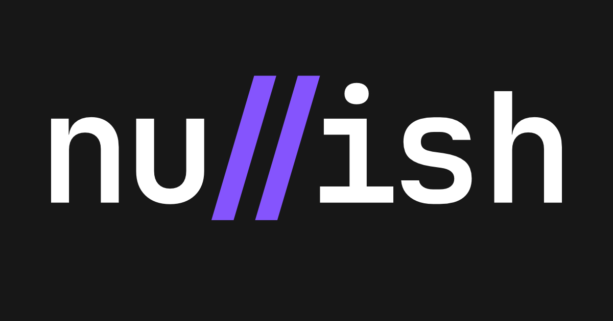

<div align="center" style="display:flex;flex-direction:column;">
  <a href="https://nullish.ch">
    
  </a>
</div>

<br />

<p align="center">
  <a href="https://github.com/usenullish/nullish/actions/workflows/checks.yml"></a>
  <a href="https://github.com/usenullish/nullish/actions/workflows/tests.yml"></a>
  <a href="https://github.com/usenullish/nullish/actions/workflows/tests-e2e.yml"></a>
  <a href="https://github.com/usenullish/nullish"></a>
</p>

Invoicing, banking and Swiss accounting you can talk to. Open-source, self-hostable.

> [!WARNING]
> **Status: alpha.** Things move fast, expect breaking changes.

## Development

> [!NOTE]
> Requires [Bun](https://bun.sh) and Docker.

```bash
bun install --frozen-lockfile
```

Run the database:

```bash
bun run db:run:dev
```

Run the API:

```bash
cd packages/server && bun run dev
```

Run the client:

```bash
cd packages/client && bun run dev
```

Optionally, run an LLM for the AI chat with [Ollama](https://ollama.com).

```bash
bun run llm:run:dev
```

Then open [http://localhost:5173](http://localhost:5173) in your browser and have fun!
